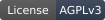
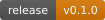
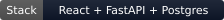
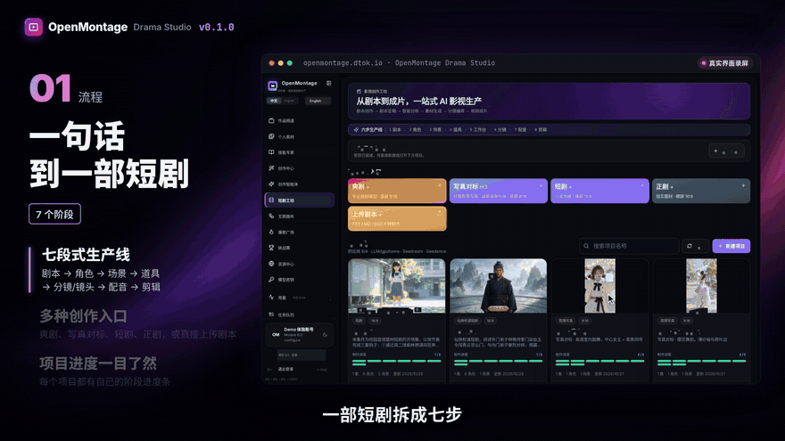
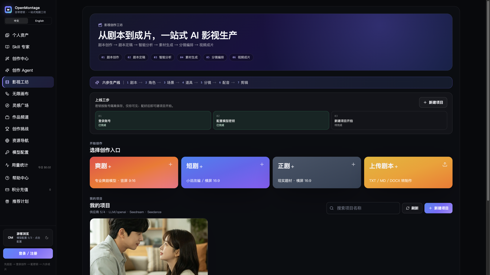
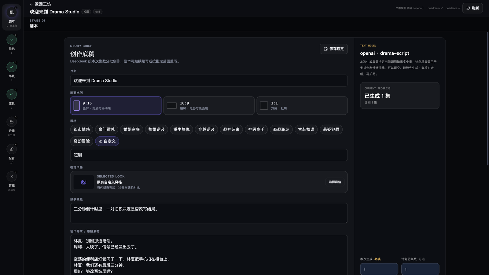
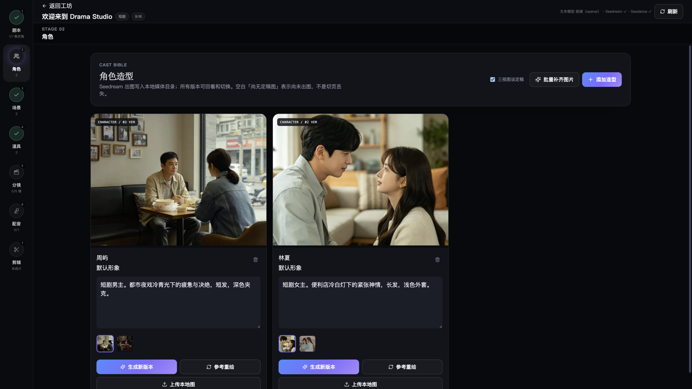
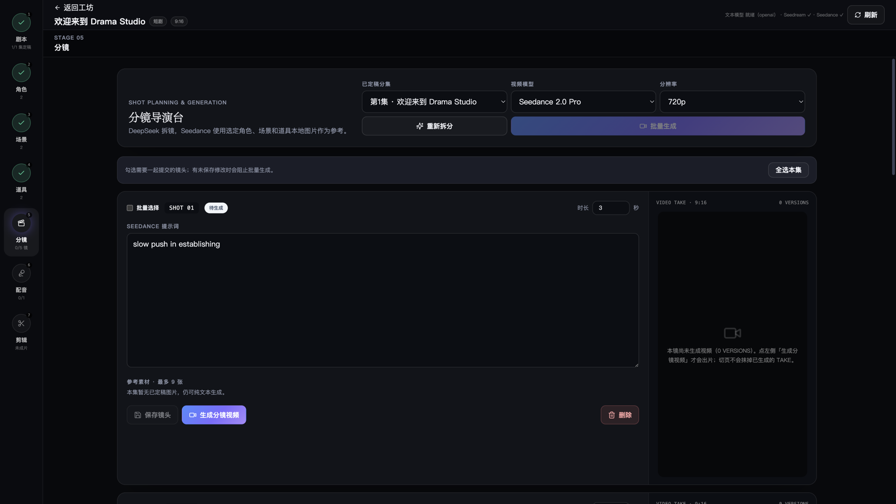
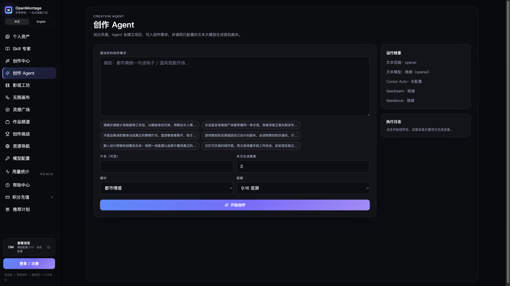
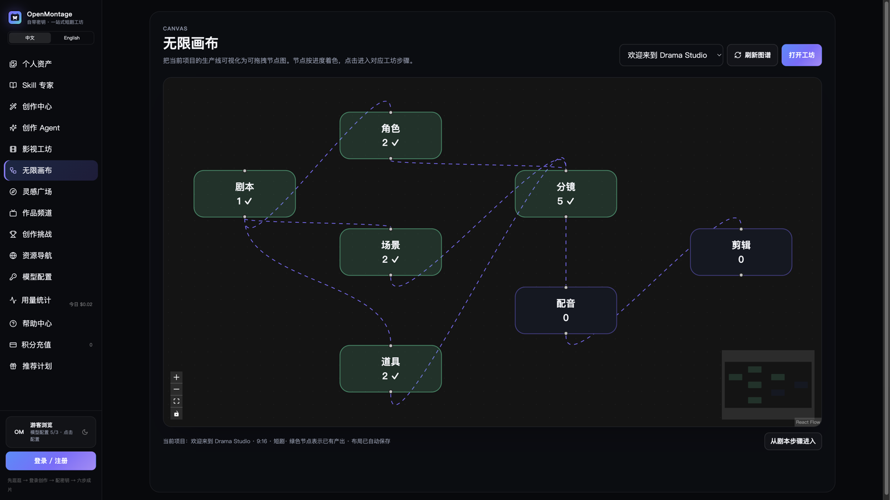

<p align="center">
  
</p>

<h1 align="center">OpenMontage Drama Studio</h1>

<p align="center">
  <strong>From a one-line idea to a finished short drama, viral short or product clip.</strong><br/>
  Script → characters → scenes → props → storyboard &amp; shots → voice → edit, in one self-hostable web studio.
</p>

<p align="center">
  <a href="https://openmontage.dtok.io/"></a>
  <a href="https://github.com/charliewwdev/OpenMontage/stargazers"></a>
  <a href="LICENSE"></a>
  <a href="https://github.com/charliewwdev/OpenMontage/releases"></a>
  
  
</p>

<p align="center">
  <a href="https://www.heroku.com/deploy?template=https://github.com/charliewwdev/OpenMontage"></a>
  &nbsp;&nbsp;
  <a href="https://cloud.digitalocean.com/apps/new?repo=https://github.com/charliewwdev/OpenMontage/tree/main"></a>
</p>
<p align="center"><sub>One-click deploy · after boot open the app → <b>Demo</b> · paste your own model keys in <i>Model settings</i> · <a href="docs/SELF_HOSTING.md#one-click-heroku--digitalocean">notes</a></sub></p>

<p align="center"><a href="README.md">简体中文</a> · <b>English</b></p>

## Demo

<!--
  TODO(charlie): put a 15–30 s clip of a real finished episode here (GIF or MP4, vertical, generated in the studio),
  with the steps it went through and the model cost it actually took (real numbers from the provider bill).
  Keep this commented out until the media exists; no placeholder images or estimated numbers.
  <p align="center"><a href="(episode MP4 link)"></a></p>
-->

<p align="center">
  <a href="https://github.com/charliewwdev/OpenMontage/releases/download/v0.1.0/drama-studio-promo-1080p.mp4"></a>
</p>
<p align="center"><em>One-line idea → script → characters &amp; scenes → storyboard workspace → rendered shots (clips from the promo video).</em></p>

<p align="center">
  ▶️ <a href="https://github.com/charliewwdev/OpenMontage/releases/download/v0.1.0/drama-studio-promo-1080p.mp4"><b>Full promo (1080p, 1:41)</b></a> ·
  <a href="https://github.com/charliewwdev/OpenMontage/releases/download/v0.1.0/drama-studio-promo-60s-vertical.mp4">60 s vertical cut</a> ·
  🌐 <a href="https://openmontage.dtok.io/"><b>Live demo</b></a> ·
  💡 <a href="docs/examples.md">Starter prompts</a>
</p>

<table>
  <tr>
    <td align="center" width="33%"><br/><sub>Workshop project library</sub></td>
    <td align="center" width="33%"><br/><sub>Script desk</sub></td>
    <td align="center" width="33%"><br/><sub>Character looks</sub></td>
  </tr>
  <tr>
    <td align="center" width="33%"><br/><sub>Storyboard desk</sub></td>
    <td align="center" width="33%"><br/><sub>Creation agent</sub></td>
    <td align="center" width="33%"><br/><sub>Infinite canvas (7-stage node graph)</sub></td>
  </tr>
</table>

<p align="center"><sub>Screenshots show the Chinese UI.</sub></p>

---

## What it is

Describe an idea in one sentence (for example *"10-episode revenge drama, 9:16, hook in the first 3 seconds"*). The
studio drafts the script, then you move it through a production line where every stage can be edited and re-run.
Characters, scenes and props become reference images that feed the video shots, so you can redo one character or one
shot without starting the episode over. Project state lives in the database, so you can close the tab and pick up later.

- **Your own keys.** Text, image and video models are configured per account in *Model settings*.
- **Browse first.** The inspiration wall, skill market and asset pages work without signing in; model calls and saving projects need a sign-in.
- **Step by step or one click.** Run each stage yourself, or let the agent run the whole pipeline in the background, then re-run any stage or swap a version.

## What it costs (read this first)

| Step | Uses | Who pays |
|:---|:---|:---|
| Script, shot breakdown and other text steps | The LLM you configure: DeepSeek, OpenAI, Claude, Gemini, Qwen, Doubao, Kimi, GLM, MiniMax, OpenRouter or any OpenAI-compatible endpoint | Your key, at the provider's price |
| Character / scene / prop images | Volcengine Ark **Seedream** (paid API), or NVIDIA NIM, Cloudflare Workers AI, Hugging Face, or your own ComfyUI | Your key or your own GPU |
| Video shots | Volcengine Ark **Seedance** (**paid API**, billed to your own key), or your own ComfyUI GPU | Your key or your own GPU |
| Voice | edge-tts by default (no key), or an OpenAI-compatible speech endpoint | — |
| Edit / export | FFmpeg on your server | — |

Self-hosted, you pay the model providers directly; this project never handles that money. The live demo at
[openmontage.dtok.io](https://openmontage.dtok.io/) (hosted by DTok) also calls the paid Seedream / Seedance APIs, which is why
it asks for a GitHub sign-in before generating and caps how many images and videos each account can make per day. The demo
also has its own credits / top-up page.

## The 7-stage workshop

| # | Stage | What happens |
|:-:|:---|:---|
| 1 | **Script** | Genre, aspect ratio, visual style, synopsis or source material; generate, continue, rewrite, lock the episode |
| 2 | **Characters** | Character art, version history, turnarounds, reference re-draws, local upload |
| 3 | **Scenes** | Space and lighting setup, scene concept art |
| 4 | **Props** | Key props and material detail |
| 5 | **Storyboard & shots** | LLM shot breakdown; each shot's video is generated with the character / scene / prop references |
| 6 | **Voice** | Narration and dialogue TTS, mixed in on export |
| 7 | **Edit** | Order the segments on a timeline and export the episode |

Stages 1–4 have their own tabs; stages 5–7 happen together per segment in the **Workspace** tab. The **infinite canvas**
shows the same seven stages as a node graph, coloured by progress.

## What you can make

- **Short dramas.** Templates for hype drama, short drama and straight drama, or upload your own script.
- **Viral short videos.** The *Viral gallery* has beat-by-beat playbooks for Douyin, TikTok, Xiaohongshu, Instagram Reels,
  YouTube Shorts and Bilibili (hooks, pacing, CTA) that you can send straight into a project. They are structural templates
  based on common feed patterns, not scraped trending charts.
- **Ad and product videos.** An e-commerce conversion template (pain point → product close-ups → benefit captions → CTA),
  a soft product-placement Reels playbook, and marketing skills in the skill market. They run through the same workshop.

## Quick start

### Docker Compose (local / VPS)

```bash
git clone https://github.com/charliewwdev/OpenMontage.git && cd OpenMontage
cp studio/.env.example .env
docker compose -f docker-compose.studio.yml up --build
# open http://localhost:8787 → click Demo
# health: GET http://localhost:8787/api/health
# MinIO console: http://localhost:9001 (minioadmin / minioadmin)
```

Compose ships the studio (UI + API + media worker), PostgreSQL 16, Redis 7 and MinIO, and boots with local Demo sign-in
(no external account service). Add your own model keys in `.env` or *Model settings* when you want to generate. Change the
default passwords and secrets in `.env` before exposing it. Details: [docs/SELF_HOSTING.md](docs/SELF_HOSTING.md) · [中文](docs/SELF_HOSTING_zh-CN.md).

### Local development

```bash
cp studio/.env.example studio/.env
# fill in DATABASE_URL, MinIO (OSS_* / MINIO_*), provider keys, then export them into your shell

cd studio/server && pip install -r requirements.txt
uvicorn app:app --host 0.0.0.0 --port 8787

cd studio && npm install && npm run dev   # http://127.0.0.1:5173, /api is proxied to 8787
```

### Public instances: GitHub sign-in + daily quota (optional)

If you open an instance to the public on your own keys, configure a GitHub OAuth App to require a GitHub sign-in before
generating and to cap images / videos per GitHub account per day:

| Variable | Default | Meaning |
|:---|:---|:---|
| `GITHUB_OAUTH_CLIENT_ID` / `GITHUB_OAUTH_CLIENT_SECRET` | empty | GitHub OAuth App credentials; callback URL `https://your-host/api/auth/github/callback` |
| `GITHUB_OAUTH_CALLBACK_URL` | `${STUDIO_PUBLIC_URL}/api/auth/github/callback` | Must match the OAuth App |
| `STUDIO_REQUIRE_GITHUB_LOGIN` | `auto` | `auto` = on only when OAuth is configured; `1` = always; `0` = off |
| `STUDIO_DAILY_GENERATION_QUOTA` | `20` | Images + video shots per GitHub account per UTC day, `0` = unlimited |
| `STUDIO_DAILY_VIDEO_QUOTA` | `5` | Video shots per GitHub account per UTC day, `0` = unlimited |

Leave them empty and a self-hosted studio is not gated. Full notes: [docs/SELF_HOSTING.md](docs/SELF_HOSTING.md#optional-github-sign-in--daily-quota-public-instances).

## Architecture

```text
  React UI (studio/src)
       │
       ▼
  FastAPI (studio/server) ──▶ PostgreSQL  (projects · studio_kv · meta)
       │            └──────▶ Redis       (media job queue)
       └──▶ MinIO / S3     (inspire · media blobs)
```

## Repository layout

| Path | Contents |
|:---|:---|
| `studio/` | Drama Studio: front end (`src/`), API (`server/`), config (`config/platform.yaml` is the single source for navigation, stages and copy) |
| `docker-compose.studio*.yml` · `Dockerfile` · `app.json` · `heroku.yml` · `.do/` | Deployment: Compose, Coolify, Heroku, DigitalOcean |
| `docs/` | Self-hosting, architecture, providers, starter prompts, screenshots |
| `lib/` · `tools/` · `schemas/` · `pipeline_defs/` · `workflow_defs/` · `skills/` · `styles/` | Agent pipelines and the tool registry (also used by the studio API) |
| `remotion-composer/` · `ink-theater/` · `backlot/` | Render engines and the local storyboard board used by the CLI pipeline |
| `scripts/` · `notebooks/` | Ops, deploy and demo-render scripts; the ComfyUI Colab notebook |
| `tests/` | Test suite (`make test`) |
| `AGENT_GUIDE.md` · `AGENTS.md` · `CLAUDE.md` · `PROJECT_CONTEXT.md` | Instructions for AI coding assistants |

## Tech stack

Python · FastAPI · React · PostgreSQL · Redis · MinIO / S3 · Seedream · Seedance · edge-tts · FFmpeg · Docker / Coolify

## Contributing

Issues and pull requests are welcome; see [CONTRIBUTING.md](CONTRIBUTING.md).

## About and license

OpenMontage Drama Studio is an independent project by [@charliewwdev](https://github.com/charliewwdev).

Licensed under the **GNU AGPL-3.0**; see [`LICENSE`](LICENSE). If you run a modified version as a network service,
AGPL-3.0 §13 requires you to offer its source to your users.
