<p align="center">
  
</p>

<h1 align="center">OpenMontage Drama Studio</h1>

<p align="center">
  <strong>一句话灵感 → 一集 AI 短剧 / 爆款短视频 / 带货片</strong><br/>
  剧本 → 角色 → 场景 → 道具 → 分镜与镜头 → 配音 → 剪辑，一个可以部署在自己服务器上的 Web 工作室。
</p>

<p align="center">
  <a href="https://openmontage.dtok.io/"></a>
  <a href="https://github.com/charliewwdev/OpenMontage/stargazers"></a>
  <a href="LICENSE">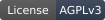</a>
  <a href="https://github.com/charliewwdev/OpenMontage/releases"></a>
  
  
</p>

<p align="center">
  <a href="https://www.heroku.com/deploy?template=https://github.com/charliewwdev/OpenMontage"></a>
  &nbsp;&nbsp;
  <a href="https://cloud.digitalocean.com/apps/new?repo=https://github.com/charliewwdev/OpenMontage/tree/main"></a>
</p>
<p align="center"><sub>一键部署 · 启动后打开站点点 <b>Demo</b> · 在「模型配置」里填你自己的模型 Key · <a href="docs/SELF_HOSTING_zh-CN.md#一键部署heroku--digitalocean">说明</a></sub></p>

<p align="center"><b>简体中文</b> · <a href="README.en.md">English</a></p>

## 演示

<!--
  TODO(charlie): 在这里放一段 15–30 秒的「真实成片」GIF 或 MP4（工作室实际生成的一集，竖屏），
  并在下面写明这一集走了哪些步骤、实际花了多少模型费用（用账单上的真实数字）。
  素材准备好之前保持注释状态，不要放占位图或估算数字。
  <p align="center"><a href="(成片 MP4 链接)"></a></p>
-->

<p align="center">
  <a href="https://github.com/charliewwdev/OpenMontage/releases/download/v0.1.0/drama-studio-promo-1080p.mp4">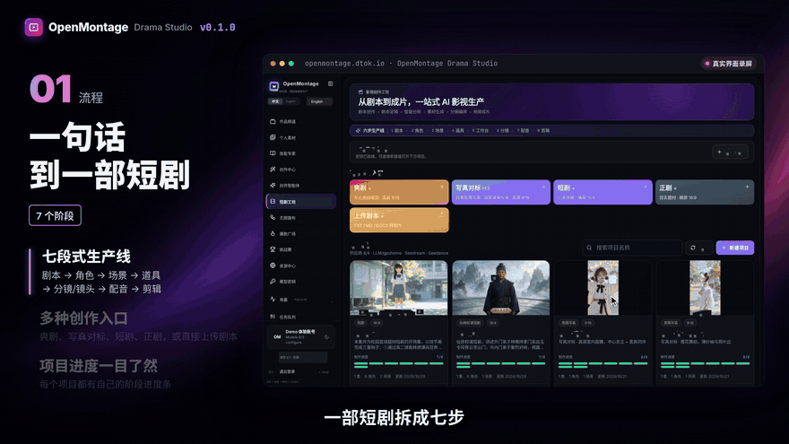</a>
</p>
<p align="center"><em>一句话灵感 → 剧本 → 角色 / 场景设定 → 分镜工作台 → 成片镜头（截自宣传片）</em></p>

<p align="center">
  ▶️ <a href="https://github.com/charliewwdev/OpenMontage/releases/download/v0.1.0/drama-studio-promo-1080p.mp4"><b>完整宣传片（1080p，1 分 41 秒）</b></a> ·
  <a href="https://github.com/charliewwdev/OpenMontage/releases/download/v0.1.0/drama-studio-promo-60s-vertical.mp4">60 秒竖版</a> ·
  🌐 <a href="https://openmontage.dtok.io/"><b>在线体验</b></a> ·
  💡 <a href="docs/examples.md">开箱提示词</a>
</p>

<table>
  <tr>
    <td align="center" width="33%">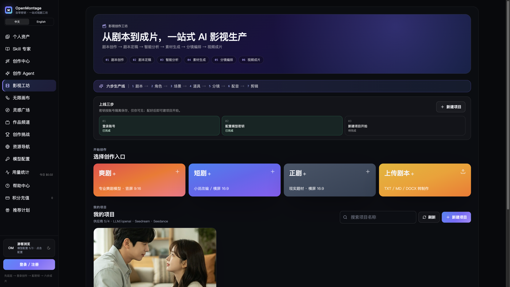<br/><sub>影视工坊项目库</sub></td>
    <td align="center" width="33%">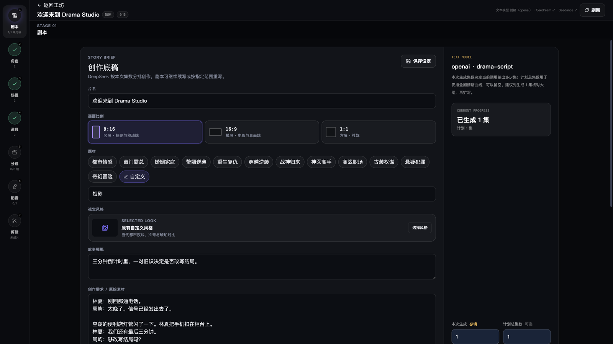<br/><sub>剧本工作台</sub></td>
    <td align="center" width="33%">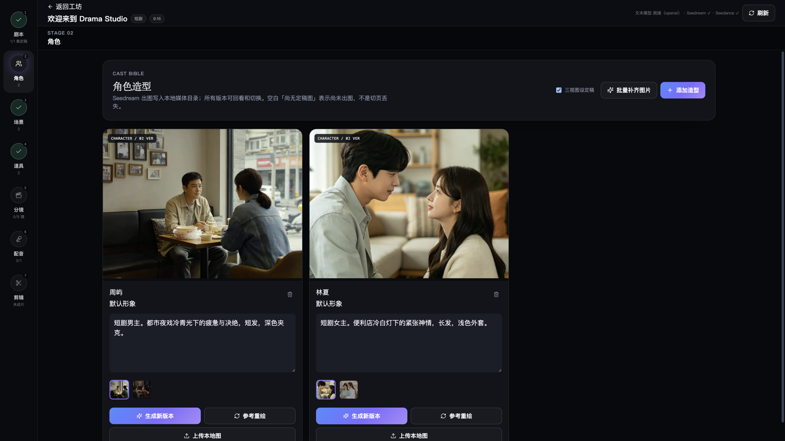<br/><sub>角色造型</sub></td>
  </tr>
  <tr>
    <td align="center" width="33%">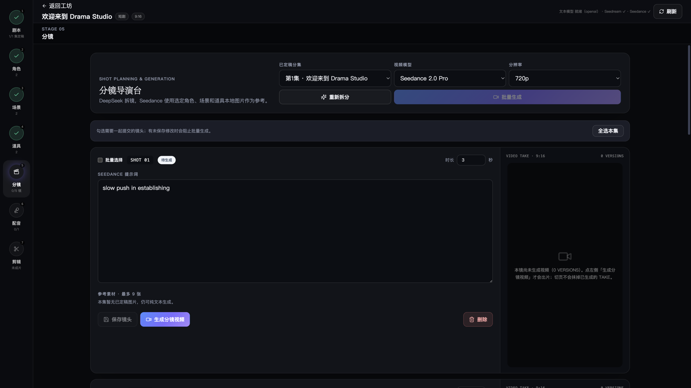<br/><sub>分镜导演台</sub></td>
    <td align="center" width="33%">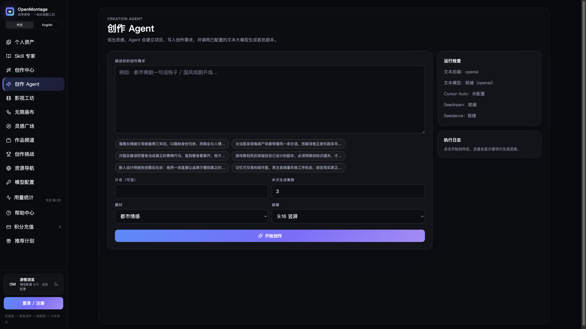<br/><sub>创作 Agent</sub></td>
    <td align="center" width="33%">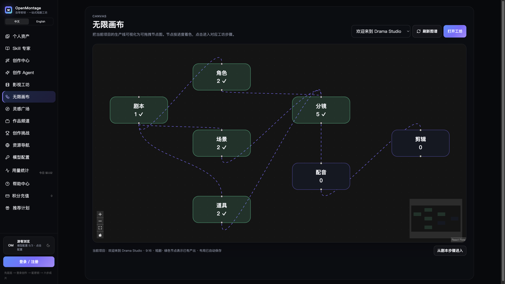<br/><sub>无限画布（七步节点图）</sub></td>
  </tr>
</table>

---

## 它是什么

一句话描述需求，例如「10 集复仇爽剧，9:16，前 3 秒强钩子」，工作室先写出剧本，再按七步生产线往下走。每一步都能单独编辑、重跑；角色、场景、道具会变成参考图，带进后面的镜头生成，所以想换一个角色造型或重拍一个镜头，不用整集重来。项目状态都存在数据库里，关掉页面再回来也接得上。

- **用你自己的 Key**：文本、图片、视频模型都在「模型配置」里按账号配置，密钥按账号隔离保存。
- **先逛再登录**：灵感墙、Skill 市场、素材页不登录也能浏览；调用模型、保存项目时才需要登录。
- **一步步或一键跑完**：可以自己逐步推进，也可以让创作 Agent 在后台一键跑完整个流程，之后再挑某一步重跑或换版本。

## 费用说明（先看这里）

| 环节 | 用什么 | 谁付费 |
|:---|:---|:---|
| 剧本、拆镜等文本步骤 | 你配置的大模型：DeepSeek、OpenAI、Claude、Gemini、通义、豆包、Kimi、智谱、MiniMax、OpenRouter 等 OpenAI 兼容接口 | 你的 Key，按各家价格计费 |
| 角色 / 场景 / 道具图片 | 火山方舟 **Seedream**（付费 API）；也可以接 NVIDIA NIM、Cloudflare Workers AI、Hugging Face 或你自己的 ComfyUI | 你的 Key 或你自己的 GPU |
| 视频镜头 | 火山方舟 **Seedance**（**付费 API**，按你自己的 Key 计费）；也可以接你自己的 ComfyUI GPU | 你的 Key 或你自己的 GPU |
| 配音 | 默认 edge-tts（不需要 Key）；也可以换成 OpenAI 兼容的语音接口 | — |
| 剪辑导出 | FFmpeg，在你的服务器上运行 | — |

自部署时，模型费用直接付给各家模型厂商，本项目不经手。演示站 [openmontage.dtok.io](https://openmontage.dtok.io/)（由 DTok 托管）的出图、出视频调用的也是付费的 Seedream / Seedance API，所以演示站生成前需要用 GitHub 登录，每个账号每天有生成次数上限；演示站另有积分 / 充值页，那只属于演示站。

## 七步工坊

| # | 阶段 | 做什么 |
|:-:|:---|:---|
| 1 | 剧本 | 题材、画幅、视觉风格、梗概或素材；生成、续写、重写、定稿 |
| 2 | 角色 | 造型参考图、版本回看、三视图、参考重绘、本地上传 |
| 3 | 场景 | 空间与光线设定、场景原画 |
| 4 | 道具 | 关键道具与材质细节 |
| 5 | 分镜与镜头 | 大模型拆镜头；参考角色 / 场景 / 道具生成每个镜头的视频 |
| 6 | 配音 | 旁白和对白 TTS，导出时混进音轨 |
| 7 | 剪辑 | 在时间轴上排列片段，导出整集 |

界面上 1–4 步各有一个标签页，5–7 步合在「工作台」里按片段一起做。「无限画布」用节点图展示同样的七步，颜色表示进度。

## 能做什么

- **短剧**：内置爽剧 / 短剧 / 正剧模板，也可以上传自己的剧本。
- **爆款短视频**：「爆款内容广场」里有抖音、TikTok、小红书、Reels、Shorts、B 站的结构模板（钩子、节奏、CTA），可以一键带进项目。这些是根据常见内容结构整理的模板，不是抓来的热榜数据。
- **带货 / 广告片**：电商转化模板（痛点 → 产品特写 → 卖点字幕 → CTA）、Reels 软植入套路，以及 Skill 市场里的营销 / 电商类技能。同样走七步工坊，没有单独的广告编辑器。

## 平台模块

| 模块 | 做什么 |
|:---|:---|
| 爆款内容广场 | 平台套路、可复制的提示词、视觉参考墙 |
| 创作中心 | 文本 / 视觉 / 音频 / 视频 / 工坊 / 画布入口 |
| 创作 Agent | 一句话建项：题材、集数、画幅、钩子；生成首批剧本，并检查哪些模型已配置 |
| 影视工坊 | 项目库和七步生产线 |
| 个人资产 | 素材库和提示词库，按角色 / 场景 / 道具 / 分镜 / 成片分类 |
| Skill 专家 | 官方和社区技能（分集剧本、镜头提示词、角色造型、导演工作流），可以装进 Agent |
| 无限画布 | 把项目生产线变成可拖拽的节点图 |
| 模型配置 | 文本和媒体供应商、连通性测试、热加载 |
| 其他 | 作品频道、创作挑战、资源导航、用量统计、任务队列、帮助中心、积分、推荐计划 |

<details>
<summary><b>更多截图</b></summary>

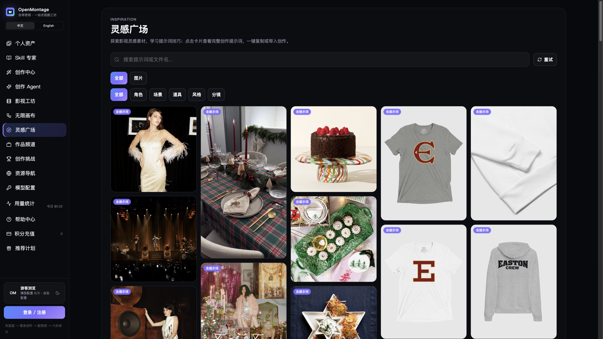
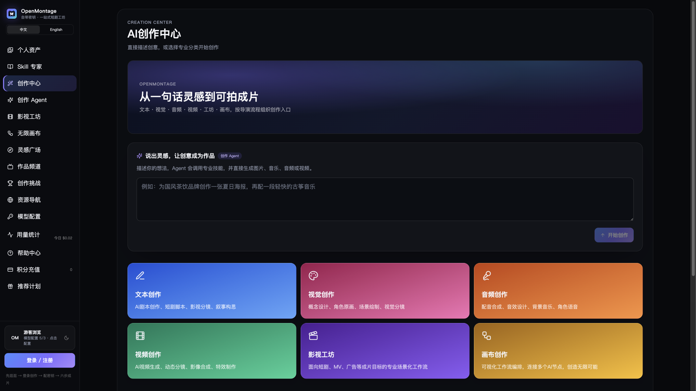
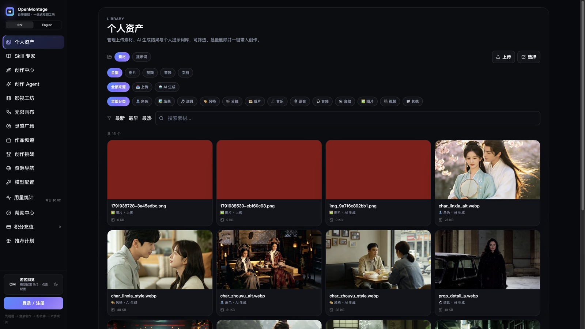
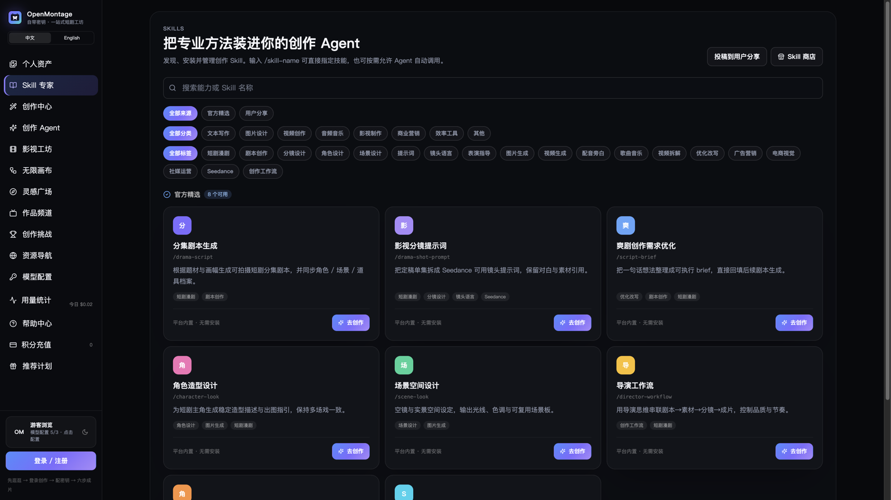

</details>

## 快速开始

### Docker Compose（本机 / VPS）

```bash
git clone https://github.com/charliewwdev/OpenMontage.git && cd OpenMontage
cp studio/.env.example .env
docker compose -f docker-compose.studio.yml up --build
# 打开 http://localhost:8787 → 点 Demo
# 健康检查：GET http://localhost:8787/api/health
# MinIO 控制台：http://localhost:9001（minioadmin / minioadmin）
```

Compose 自带 Studio（前端 + API + 媒体 worker）、PostgreSQL 16、Redis 7 和 MinIO，默认用本地 Demo 登录，不依赖外部账号服务。要生成内容时，在 `.env` 或「模型配置」里填上你自己的模型 Key。部署到公网前，把 `.env` 里的默认密码和密钥都换掉。详细说明：[docs/SELF_HOSTING_zh-CN.md](docs/SELF_HOSTING_zh-CN.md) · [English](docs/SELF_HOSTING.md)。

### 本地开发

```bash
cp studio/.env.example studio/.env
# 填写 DATABASE_URL、MinIO（OSS_* / MINIO_*）、模型 Key，并导出到当前 shell

cd studio/server && pip install -r requirements.txt
uvicorn app:app --host 0.0.0.0 --port 8787

cd studio && npm install && npm run dev   # http://127.0.0.1:5173，/api 代理到 8787
```

### 公开部署：GitHub 登录 + 每日额度（可选）

如果你用自己的 Key 开放一个公开站点，可以配置一个 GitHub OAuth App，要求访客用 GitHub 登录后才能生成，并限制每个 GitHub 账号每天的图片 / 视频次数：

| 变量 | 默认 | 说明 |
|:---|:---|:---|
| `GITHUB_OAUTH_CLIENT_ID` / `GITHUB_OAUTH_CLIENT_SECRET` | 空 | GitHub OAuth App 凭据；回调地址填 `https://你的域名/api/auth/github/callback` |
| `GITHUB_OAUTH_CALLBACK_URL` | `${STUDIO_PUBLIC_URL}/api/auth/github/callback` | 必须和 OAuth App 里填的一致 |
| `STUDIO_REQUIRE_GITHUB_LOGIN` | `auto` | `auto`：配了 OAuth 才开启；`1`：始终开启；`0`：关闭 |
| `STUDIO_DAILY_GENERATION_QUOTA` | `20` | 每个 GitHub 账号每个 UTC 日的图片 + 视频次数，`0` 为不限 |
| `STUDIO_DAILY_VIDEO_QUOTA` | `5` | 其中视频镜头的上限，`0` 为不限 |

不设置这些变量时，自部署照常使用，不会被拦。完整说明见 [docs/SELF_HOSTING_zh-CN.md](docs/SELF_HOSTING_zh-CN.md#可选github-登录--每日额度公开站点用)。

## 架构

```text
  React UI (studio/src)
       │
       ▼
  FastAPI (studio/server) ──▶ PostgreSQL  (projects · studio_kv · meta)
       │            └──────▶ Redis       (媒体任务队列)
       └──▶ MinIO / S3     (inspire · media blobs)
```

## 仓库结构

| 路径 | 内容 |
|:---|:---|
| `studio/` | Drama Studio：前端（`src/`）、API（`server/`）、配置（`config/platform.yaml` 是导航、工坊步骤、文案的唯一配置来源） |
| `docker-compose.studio*.yml` · `Dockerfile` · `app.json` · `heroku.yml` · `.do/` | 部署：Compose、Coolify、Heroku、DigitalOcean |
| `docs/` | 自部署、架构、模型供应商、示例提示词、截图 |
| `lib/` · `tools/` · `schemas/` · `pipeline_defs/` · `workflow_defs/` · `skills/` · `styles/` | Agent 管线和工具注册表（Studio 的 API 也会用到） |
| `remotion-composer/` · `ink-theater/` · `backlot/` | 命令行管线用到的渲染引擎和本地分镜板 |
| `scripts/` · `notebooks/` | 运维、部署、演示渲染脚本；ComfyUI Colab 笔记本 |
| `tests/` | 测试（`make test`） |
| `AGENT_GUIDE.md` · `AGENTS.md` · `CLAUDE.md` · `PROJECT_CONTEXT.md` | 给 AI 编程助手看的说明 |

## 技术栈

Python · FastAPI · React · PostgreSQL · Redis · MinIO / S3 · Seedream · Seedance · edge-tts · FFmpeg · Docker / Coolify

## 参与贡献

欢迎 issue 和 PR，见 [CONTRIBUTING.md](CONTRIBUTING.md)。

## 关于与许可证

OpenMontage Drama Studio 是 [@charliewwdev](https://github.com/charliewwdev) 的独立项目。

本项目以 **GNU AGPL-3.0** 授权，见 [`LICENSE`](LICENSE)。如果你把修改后的版本作为网络服务提供给他人使用，AGPL-3.0 第 13 条要求你向用户提供对应源码。
