<p align="center">
  
</p>

<h1 align="center">OpenMontage Drama Studio</h1>

<p align="center">
  <strong>From a one-line idea to a finished short drama, viral short or product clip.</strong><br/>
  Script → characters → scenes → props → storyboard &amp; shots → voice → edit, in one self-hostable web studio.
</p>

<p align="center">
  <a href="https://openmontage.dtok.io/"></a>
  <a href="https://github.com/charliewwdev/OpenMontage/stargazers"></a>
  <a href="LICENSE"></a>
  <a href="https://github.com/charliewwdev/OpenMontage/releases"></a>
  
  
  
</p>

<p align="center">⭐ If this is useful, a star helps others find it.</p>

<p align="center"><b>English</b> · <a href="README_zh-CN.md">简体中文</a></p>

<!--
  DEMO GIF PLACEHOLDER (TODO before launch)
  Record a 20–30 s capture: type one line → walk through the 7 stages → play the exported clip.
  Save as docs/demo.gif (< 10 MB) or upload an MP4 to a GitHub issue/release, then replace this comment with:
  <p align="center"></p>
-->

---

## What it is

OpenMontage Drama Studio is a web studio for making short-form video with AI. You describe an idea in one
sentence (for example *"10-episode revenge drama, 9:16, hook in the first 3 seconds"*), the studio drafts the
script, and you move it through a production line where every stage is editable. Characters, scenes and props
become reference images that feed the video shots, so you can redo a single character or shot without starting over.

- **Bring your own keys.** Text models, image models and video models are configured per account in *Model settings*.
- **Browse first.** The inspiration wall, skills and asset pages can be browsed without signing in; signing in is
  required for model calls and saving projects.
- **Step by step or one click.** Run each stage yourself, or let the agent run the whole pipeline in the background
  and then re-run any stage or swap a version.

Try the hosted instance: **[openmontage.dtok.io](https://openmontage.dtok.io/)**

## The 7-stage workshop

| # | Stage | What happens |
|:-:|:---|:---|
| 1 | **Script** (剧本) | Genre, aspect ratio, visual style, synopsis or source material; generate, continue, rewrite, lock the episode |
| 2 | **Characters** (角色) | Character art (Seedream, or ComfyUI on your own GPU), version history, turnarounds, reference re-draws, local upload |
| 3 | **Scenes** (场景) | Space and lighting setup, scene concept art |
| 4 | **Props** (道具) | Key props and material detail |
| 5 | **Storyboard & shots** (分镜) | LLM shot breakdown; Seedance generates each shot using the character / scene / prop references |
| 6 | **Voice** (配音) | Narration and dialogue TTS (edge-tts by default, OpenAI-compatible speech as fallback), mixed in on export |
| 7 | **Edit** (剪辑) | Order the segments on a timeline and export the episode |

In the current UI, stages 1–4 have their own tabs and stages 5–7 happen together per segment in the
**Workspace** (工作台) tab. The **infinite canvas** shows the same seven stages as a node graph, coloured by progress.

## What you can make

- **Short dramas.** Project templates for 爽剧 (hype drama), 短剧 (short drama) and 正剧 (straight drama), or upload your own script.
- **Viral short videos.** The *Viral gallery* (爆款内容广场) has beat-by-beat playbooks for Douyin, TikTok, Xiaohongshu,
  Instagram Reels, YouTube Shorts and Bilibili (hooks, pacing, CTA) that you can send straight into a project.
  These are structural templates based on common feed patterns, not scraped trending charts.
- **Ad and product videos.** A built-in e-commerce conversion template (pain point → product demo close-ups →
  benefit captions → CTA), a soft product-placement Reels playbook, and marketing / e-commerce skills in the
  skill market. They run through the same workshop; there is no separate ad editor.

## Platform modules

| Module | What it does |
|:---|:---|
| Viral gallery (爆款内容广场) | Platform playbooks, copyable prompts, a visual reference wall |
| Creation hub (创作中心) | Text / visual / audio / video / workshop / canvas entry points |
| Creation agent (创作 Agent) | One-line project setup: genre, episode count, aspect ratio, hook; generates the first scripts and checks which models are configured |
| Workshop (影视工坊) | Project library and the 7-stage production line |
| Assets (个人资产) | Media and prompt library, filtered by character / scene / prop / storyboard / final cut |
| Skill market (Skill 专家) | Official and community skills (episode scripts, shot prompts, character looks, director workflows) you can install into the agent |
| Infinite canvas (无限画布) | The project pipeline as a draggable node graph |
| Model settings (模型配置) | Text and media providers, connection test, hot reload without restart |
| Also | Works channel, challenges, resources, usage stats, task queue, help center, credits, referral program |

<details>
<summary><b>Screenshots</b></summary>

Viral gallery
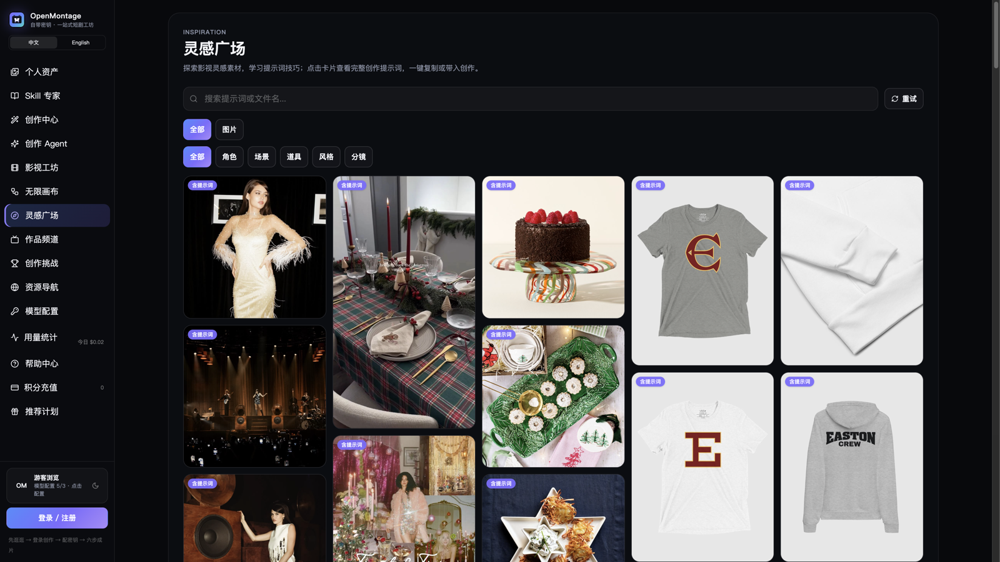

Creation hub
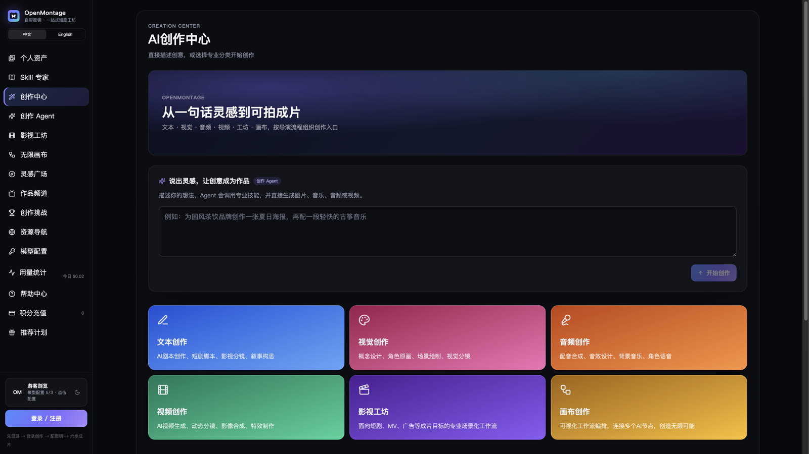

Creation agent
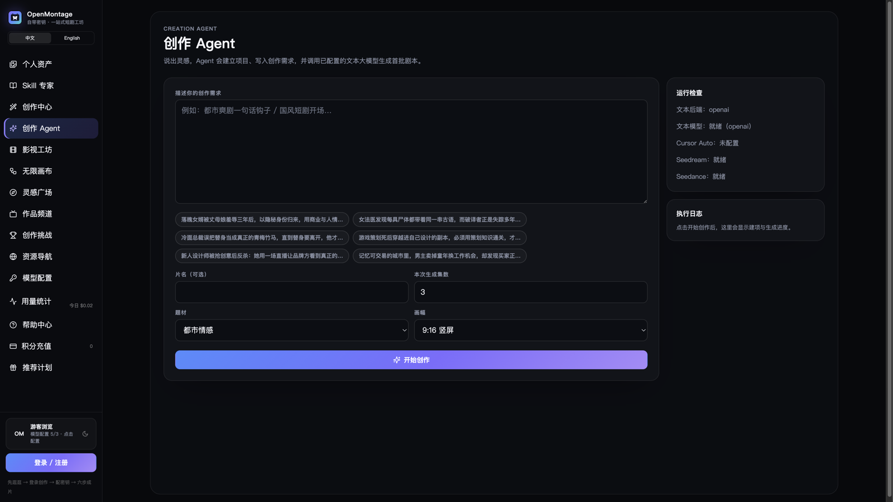

Workshop
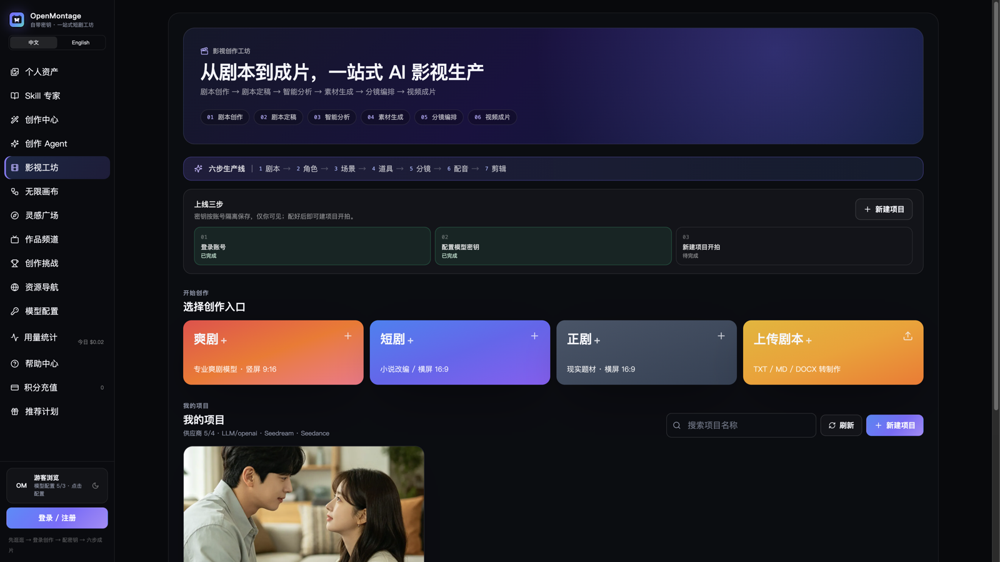

Script desk
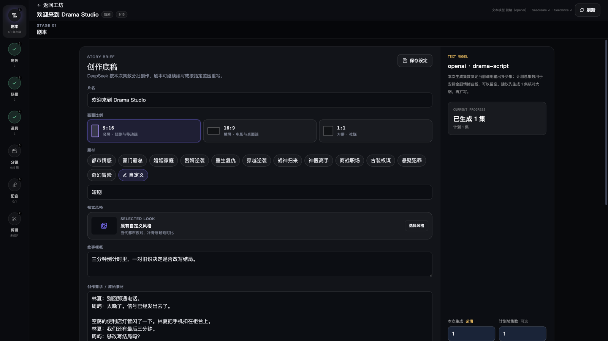

Character looks
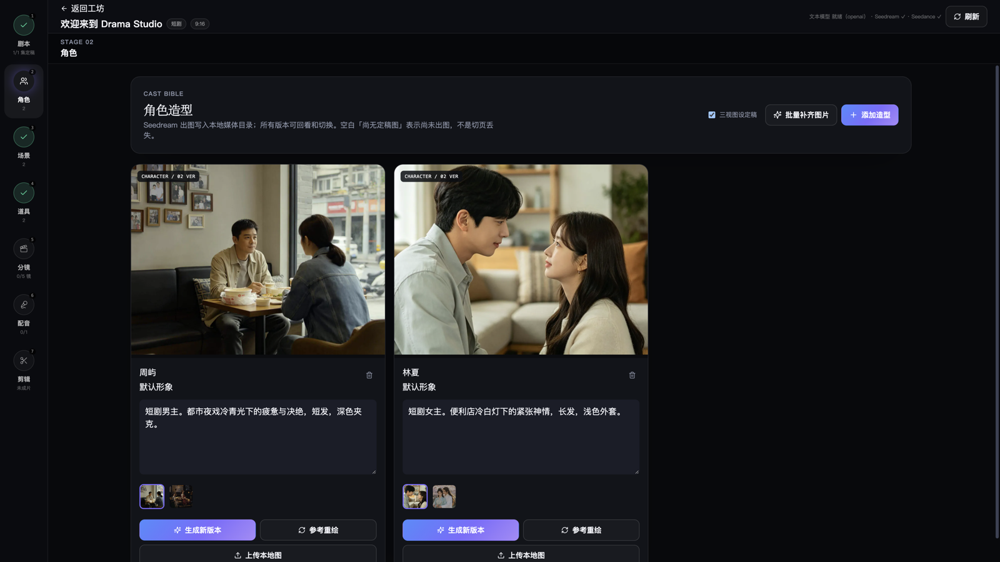

Storyboard desk
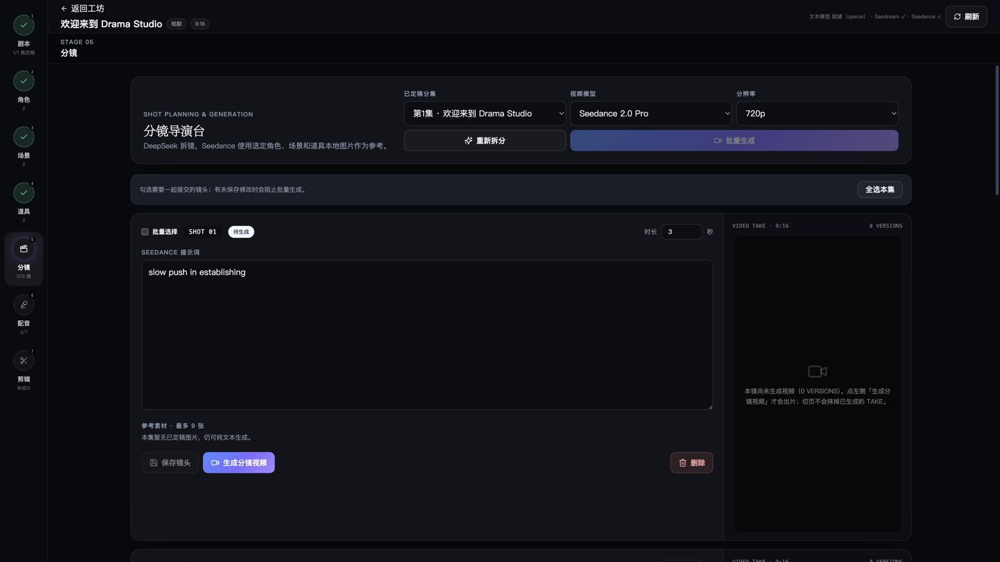

Assets
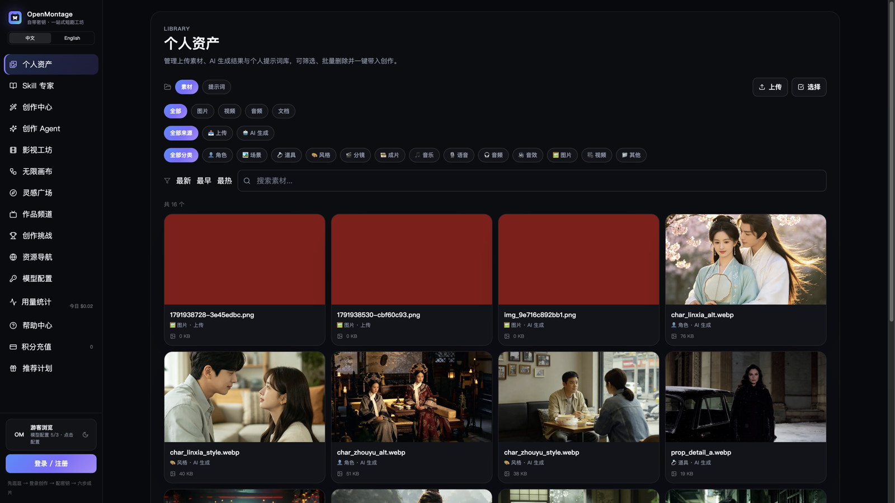

Skill market
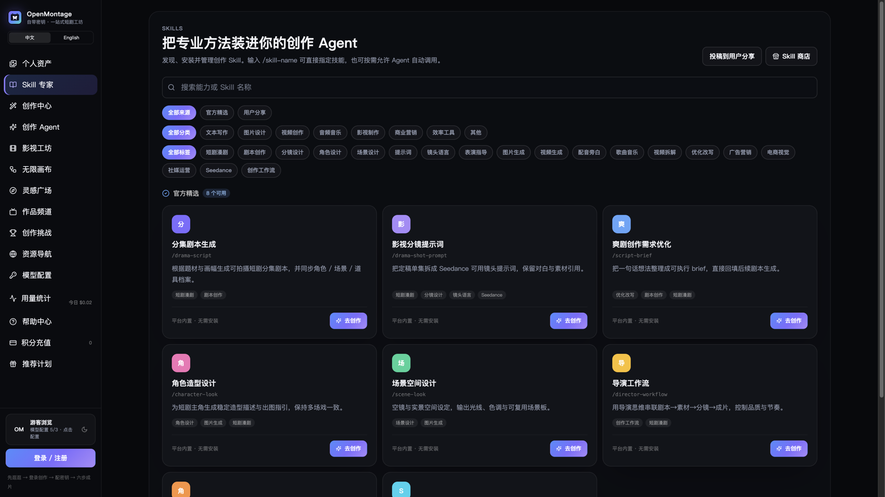

Infinite canvas
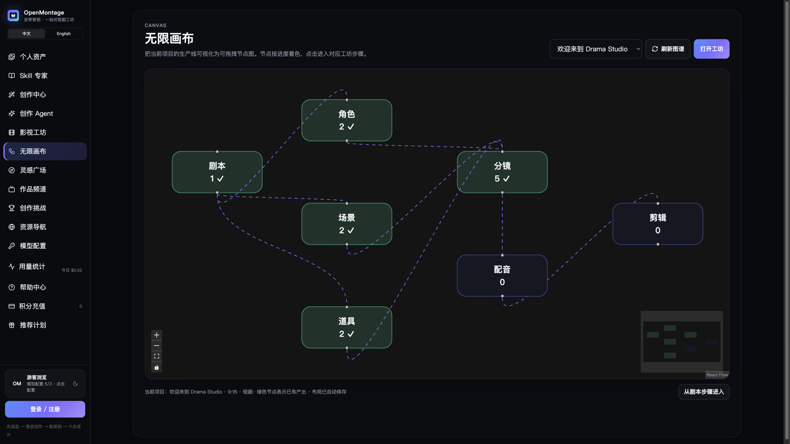

Model settings
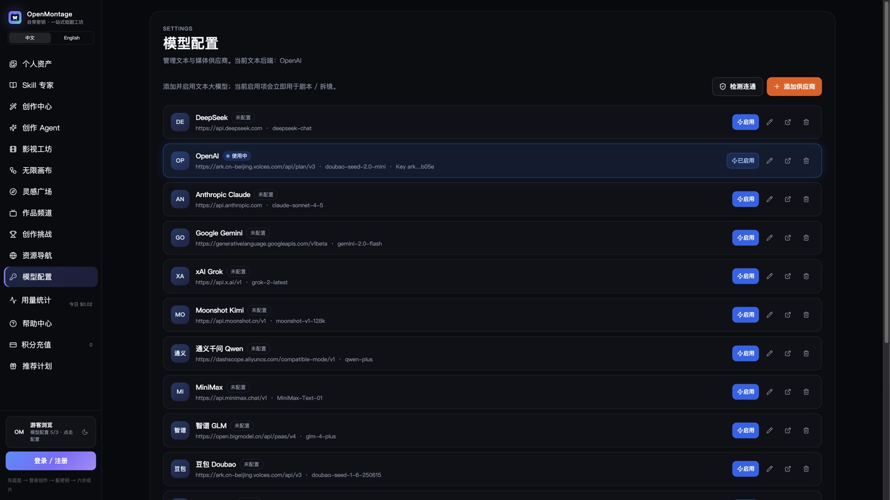

</details>

## Architecture

```text
  React UI (studio/src)
       │
       ▼
  FastAPI (studio/server) ──▶ PostgreSQL  (projects · studio_kv · meta)
       │            └──────▶ Redis       (media job queue)
       └──▶ MinIO / S3     (inspire · media blobs)
```

| Path | Contents |
|:---|:---|
| `studio/` | Drama Studio front end and API |
| `studio/config/platform.yaml` | Navigation, workshop stages, tools, copy (single source of truth) |
| `pipeline_defs/` · `skills/` | Agent pipelines and director skills |
| `lib/` · `tools/` | Tool registry |
| `docs/screenshots/` | Screenshots used in this README |

## Requirements (read before self-hosting)

| | Included in `docker-compose.studio.yml`? |
|:---|:---|
| Studio app (UI + API) and media worker | ✅ built from this repo |
| PostgreSQL 16 | ✅ bundled |
| Redis 7 (media job queue) | ✅ bundled |
| S3-compatible object storage (MinIO / S3) | ❌ **you provide** an endpoint, access key, secret and bucket (`OSS_*` / `MINIO_*` / `S3_*`) |
| Text LLM key | ❌ **you provide**: DeepSeek, OpenAI, Claude, Gemini, Qwen (通义), Doubao (豆包), Kimi, GLM, MiniMax, OpenRouter or another OpenAI-compatible endpoint |
| Image + video generation | ❌ **you provide**: a Volcengine Ark key for **Seedream** (images) and **Seedance** (video). These are **paid third-party APIs**. Images can instead go to your own ComfyUI server. |
| TTS | edge-tts by default (no key); optional OpenAI-compatible speech endpoint |

Other things to know:

- `studio/.env.example` ships with defaults for the hosted instance (`openmontage.dtok.io`, its MinIO host and the
  DTok account API in `API_BASE_URL`). Replace them with your own values. By default sign-in is proxied to the
  account API in `API_BASE_URL`; see `STUDIO_AUTH_REQUIRED` and the demo-user settings in the same file.
- The hosted instance has a credits / top-up page. Self-hosted, you pay your model providers directly.

## Quick start

Docker (Compose reads `.env` from the repo root):

```bash
cp studio/.env.example .env
# fill in DATABASE_URL (or keep the bundled drama-db default), your S3/MinIO settings, and model API keys
docker compose -f docker-compose.studio.yml up --build
# open http://localhost:8787 · health check: GET /api/health (Postgres + object storage)
```

Local development:

```bash
cp studio/.env.example studio/.env
# fill in DATABASE_URL, MinIO (OSS_*), provider keys, then export them into your shell

cd studio/server && pip install -r requirements.txt
uvicorn app:app --host 0.0.0.0 --port 8787

cd studio && npm install && npm run dev   # http://127.0.0.1:5173, /api is proxied to 8787
```

Agent / CLI pipeline notes: [`AGENT_GUIDE.md`](AGENT_GUIDE.md).

## Tech stack

Python · FastAPI · React · PostgreSQL · Redis · MinIO / S3 · Seedream · Seedance · edge-tts · FFmpeg · Docker / Coolify

## About the name

OpenMontage Drama Studio is an independent product by [@charliewwdev](https://github.com/charliewwdev).
It started from the AGPL-3.0 [calesthio/OpenMontage](https://github.com/calesthio/OpenMontage) codebase and has
since been rebuilt into a separate short-drama studio. It is **not affiliated with or endorsed by** the upstream
project. The repository keeps the upstream git history, so upstream authors appear in the contributor list.

## License and attribution

Licensed under the **GNU AGPL-3.0**; see [`LICENSE`](LICENSE).

This is a modified version of [calesthio/OpenMontage](https://github.com/calesthio/OpenMontage). Original code is
copyright its respective authors; modifications are by @charliewwdev (see the git history for what changed and when).
If you run a modified version as a network service, AGPL-3.0 §13 requires you to offer its source to your users.
